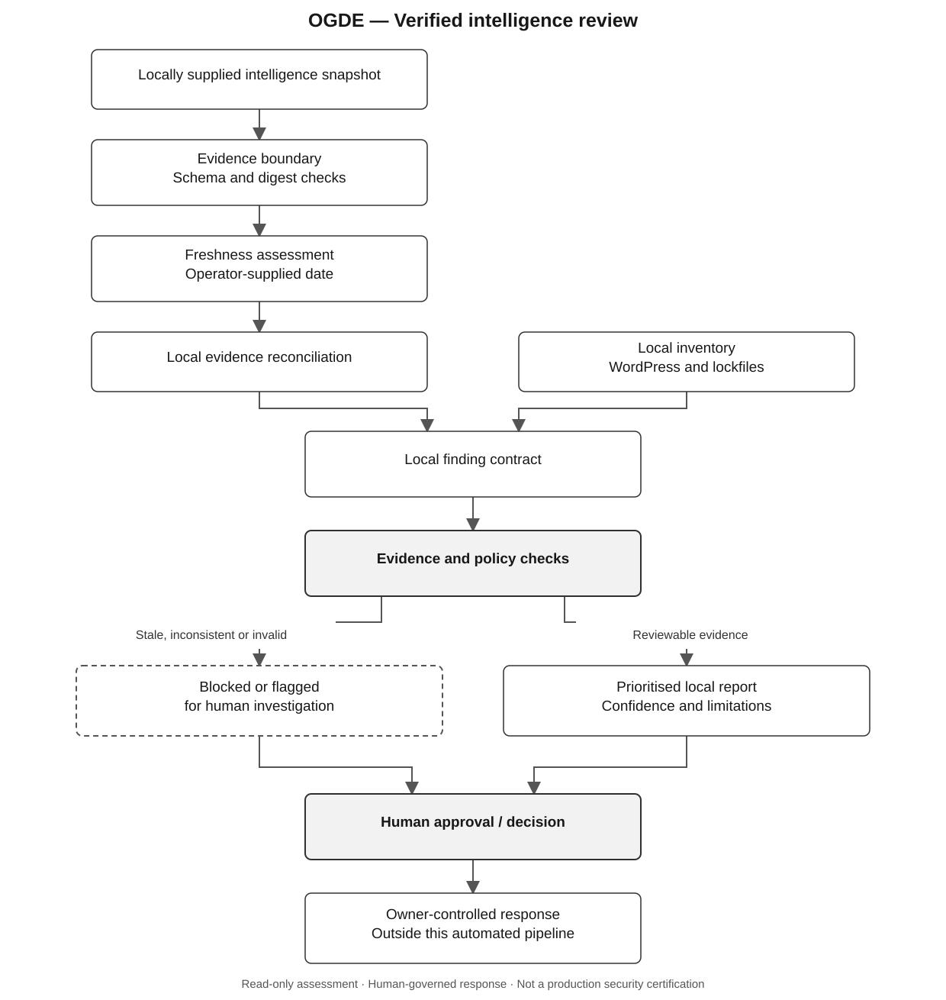

<p align="center">
  
</p>

<h1 align="center">One Global Defence Ecosystem</h1>
<p align="center"><strong>Defend locally. Verify globally. Recover together.</strong></p>
<p align="center">A privacy-preserving, evidence-led foundation for interoperable cyber-defence.</p>

<p align="center">
  <a href="LICENSE">MIT licence</a> ·
  <a href="SECURITY.md">Security policy</a> ·
  <a href="docs/V0.3.md">v0.3 plan</a> ·
  <a href="docs/ROADMAP_AUTONOMY.md">Engineering roadmap</a> ·
  <a href="https://github.com/ymmiah/OGDE/actions">CI history</a>
</p>

> [!IMPORTANT]
> **Developer preview — not a production security control.** v0.2.2 is the published baseline; v0.3 is under active development. Passing a unit test or verifying a digest is not proof that threat intelligence is correct, complete, fresh or publisher-authenticated. Do not rely on OGDE as your sole security control.

## Mission

OGDE explores a neutral, locally governed cyber-defence ecosystem. Organisations retain control of their inventories and response decisions while sharing or consuming **verifiable, reviewable intelligence** through explicitly authorised interfaces.

The current engineering target is a small, demonstrable loop: **intelligence → local matching → evidence-backed finding → human decision**. WordPress installations and CI/CD dependency lockfiles are the first inventory targets. This is an experimental implementation, not an operational global threat-sharing network.

## Architecture at a glance

The diagram below retains the **same v0.3 review process, decision points and trust boundaries**. Its presentation follows the restrained, monochrome **PRISMA 2020-style flowchart convention** (clear process boxes and explicit branches); it is an engineering workflow illustration, **not** a PRISMA systematic-review report. No system functionality is changed by this diagram.

<p align="center">
  
</p>

[Open the full-size architecture diagram](assets/diagrams/ogde-v03-review-flow.svg)


**Reading the flow:** the left-hand local inventory and the checked intelligence evidence converge at the finding contract. Invalid or inconsistent evidence is flagged for investigation; reviewable evidence reaches a local report. Both paths require a human decision. **No automated response is authorised.**

**Trust boundary:** a matching SHA-256 digest demonstrates equality with a separately pinned digest; it does **not** authenticate CISA, prove feed freshness or establish that a local asset is vulnerable. Publisher authentication, asset applicability and remediation authorisation remain separate decisions.

## Verified repository baseline versus work in review

| Capability | Status | What it actually does |
| --- | --- | --- |
| v0.2.2 signed advisory assessment | **On `main`** | Ed25519 verification, pinned keys, exact-version matching and local assessment. |
| `ogde inventory` | **On `main`** | Local CycloneDX inventory from WordPress files, `composer.lock` and `package-lock.json`; no upload. |
| `ogde report` | **On `main`** | Local finding validation, confidence and prioritisation, OpenVEX handling and audit output. |
| Evidence consistency and SHA-256 validation | **On `main`** | Rejects malformed evidence digests and conflicting digest claims for the same evidence identity. |
| Offline KEV snapshot ingestion | **On `main` / verify active revision** | Pinned-digest validation and a review-only ingestion receipt; no live CISA fetch. |
| KEV snapshot freshness policy | **Draft [PR #11](https://github.com/ymmiah/OGDE/pull/11)** | Operator-dated, configurable age assessment; not publisher-authenticated. |
| Local KEV-to-finding reconciliation | **Draft [PR #12](https://github.com/ymmiah/OGDE/pull/12)** | Flags mismatches between recorded KEV signals and a validated local snapshot; does not change findings. |
| Integrated KEV review pipeline | **Draft [PR #13](https://github.com/ymmiah/OGDE/pull/13)** | Composes pinned ingestion, freshness and reconciliation into a human-review result; includes changes from the earlier draft branches. |
| TUF / Sigstore trust integration | **Specification only** | Not implemented or enabled. |
| Live multi-source intelligence, automated remediation, production agent | **Not implemented** | Not part of the current developer preview. |

**Review note:** the M3 draft branches overlap. Their pull requests are not independent production releases; review and reconcile the changes before merging. The table reports repository development state, not successful deployment or independently verified CI results.

## Run the available baseline

Requires a supported Python environment. The commands below operate locally; the example findings are synthetic.

```bash
python -m pip install -e .
python -m unittest discover -s tests -v

mkdir -p .ogde-local

ogde inventory \
  --wordpress examples/demo-site/wordpress \
  --composer-lock examples/demo-site/composer.lock \
  --package-lock examples/demo-site/package-lock.json \
  --out .ogde-local/inventory.cdx.json

ogde report \
  --findings examples/findings.example.json \
  --vex examples/vex.example.json \
  --out .ogde-local/findings.json \
  --markdown .ogde-local/findings.md
```

`ogde report` intentionally exits with code `2` when a visible finding remains in the synthetic example. The historical `odge` command/import is retained as an alias; there is no separate implementation. See [signed-feed documentation](docs/FEDERATION_V2.md) for the earlier verifier.

The new M3 modules are under review and are **not advertised as stable CLI commands**.

## Security and privacy guarantees — and limits

- **Local-first:** inventories and findings remain on the operator's machine by default.
- **Explicit consent:** network-enabled features require operator authorisation; the M3 offline pipeline makes no network requests.
- **Read-only assessment:** intelligence and advisory text are data, never commands.
- **Fail closed:** invalid schemas, mismatched pinned digests and inconsistent evidence must not silently become trusted findings.
- **Human-governed response:** no automatic patching, isolation, privilege escalation or production changes.
- **Evidence honesty:** signatures authenticate signers, not the truth of a vulnerability claim; KEV listing does not prove exploitation of a particular asset.
- **Scope limitation:** these are design and implementation properties of the described paths, not an independently audited platform-wide security certification.

## Delivery gates and next work

The v0.3 exit gate is **five pilot sites over four weeks and a published false-positive rate**. This gate has **not** been met. Before any production-readiness claim, OGDE needs end-to-end integration tests, documented provenance and freshness policy, measured false positives, security review, and owner-approved pilot evidence.

Near-term engineering work: consolidate the overlapping M3 pull requests, verify GitHub Actions on the actual merge candidate, add structured local audit records and deterministic failure reporting, and evaluate authenticated source provenance. Longer-term milestones are in [the autonomy roadmap](docs/ROADMAP_AUTONOMY.md).

## Contributing and responsible disclosure

Read [SECURITY.md](SECURITY.md) before reporting vulnerabilities; disclose sensitive issues privately. Do not test against third-party infrastructure without authorisation.

**Project:** [github.com/ymmiah/OGDE](https://github.com/ymmiah/OGDE) · **Licence:** [MIT](LICENSE) · **Project phase:** v0.3 experimental developer preview.
